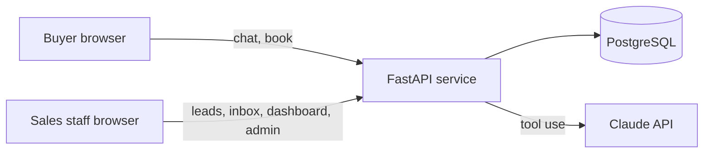

<div align="center">
# 🏡 Site-Visit Assistant
 
### An AI assistant that answers every property enquiry in minutes and books site visits into real free slots
 
🗣️ English · हिन्दी · ગુજરાતી &nbsp;|&nbsp; 🛡️ Guardrails enforced in code &nbsp;|&nbsp; 🔒 Double-booking-proof
 


 
</div>
---
 
Built for a residential developer in Ahmedabad that pays for every lead and lets a third of them go cold. This is a take-home build for **brief 1: real estate AI lead-response and site-visit booking assistant**.
 
## ✨ Highlights
 
- ⚡ **Instant answers.** Buyers get a reply in seconds, at any hour, in their own language.
- 📚 **No made-up facts.** The assistant speaks only from the developer's fact sheet. If a fact is missing, a person confirms it.
- 🗓️ **Real slots only.** Buyers see free slots only, and two buyers can never book the same one.
- 🤝 **Smooth handoff.** Serious buyers go to a named salesperson with a chat summary.
- 📊 **Clear numbers.** Response time, visits, show-up rate and cost per visit, by lead source.
- 🔐 **Privacy built in.** Consent first, opt-out any time, and RERA numbers shown where required.
## 🎯 What it does
 
| 🙋 For buyers | 🧑‍💼 For the sales team |
|---|---|
| Chat in English, Hindi or Gujarati and get answers from the developer's own fact sheet | One lead list from every source, with duplicate enquiries merged automatically |
| See only **free** visit slots and book in two taps, with a map pin and RERA number | A named executive receives each serious buyer, with a chat summary |
| Reminders 1 day and 2 hours before the visit | A dashboard of response time, visits, show-up rate and cost per visit by source |
| Ask for a person at any time, or opt out | A daily review queue of chats the assistant was unsure about |
 
## 🧩 The hard part: no double booking
 
Two buyers can tap the same slot at the same moment. The guarantee lives in the **database**, not only in code: a partial unique index allows one active booking per slot. Booking runs in a single transaction, and a test fires **five simultaneous bookings** at one slot and checks that exactly one wins.
 
## 🛡️ How the AI stays safe
 
The assistant is Claude with four tools (list free slots, book, save the buyer's needs, request a person). The rules that must never break are enforced **in code**, not only in the prompt.
 
| 🚦 Situation | ✅ What happens |
|---|---|
| Buyer asks for a final price or a discount | Caught before the model runs. A fixed reply says a team member will confirm, a handoff is created and the chat is flagged |
| Buyer asks for a person | Immediate handoff to their named executive |
| A fact is missing from the fact sheet | "A person will confirm" plus a handoff and a flag. No guessing |
| The model's reply mentions a discount or offer | An output filter replaces it with the safe message |
| Claude is down or no API key is set | A rule-based mode answers from the fact sheet with the same guardrails |
| The model sends a bad tool input | The tool rejects it |
 
## 🏗️ Architecture
 

 
| Layer | Choice |
|---|---|
| 🎨 Frontend | React + Vite, plain CSS, hash routing (deploys to any static host) |
| ⚙️ Backend | FastAPI with typed validation and role checks |
| 🗄️ Database | PostgreSQL (transactions and partial unique indexes) |
| 🤖 AI | Claude API with tool use, plus a rule-based fallback |
 
## 🖥️ Screens
 
| Area | Screen | What it is for |
|---|---|---|
| 🙋 Buyer | Start | Name, phone, language and consent |
| 🙋 Buyer | Chat | Ask questions, get answers, see when a person takes over |
| 🙋 Buyer | Site visit | Pick a free slot, confirm, view the booking, cancel |
| 🧑‍💼 Staff | Leads | Filter by source, import a CSV, read any chat |
| 🧑‍💼 Staff | Inbox | Handoffs with summaries, and one-tap Visited or No-show |
| 🧑‍💼 Staff | Dashboard | Median first response, visits, show-up rate, cost per visit |
| 🧑‍💼 Staff | Review | Flagged chats and the mock reminder sender |
| 🧑‍💼 Staff | Admin | Edit the fact sheet and visit slots |
 
## 🚀 Quick start
 
Full step-by-step instructions, including deployment, are in **[deployment.md](deployment.md)**. The short version:
 
```bash
# 1. Backend (Python 3.10+ and PostgreSQL needed)
python -m venv venv
venv\Scripts\activate            # macOS/Linux: source venv/bin/activate
pip install -r backend/requirements.txt
copy .env.example .env           # macOS/Linux: cp .env.example .env  (then fill it in)
psql -U postgres -h localhost -d sv -f backend/db/schema.sql
python backend/seed.py
cd backend && python -m uvicorn app.main:app --reload
 
# 2. Frontend, in a second terminal
cd frontend
copy .env.example .env
npm install
npm run dev                      # open http://localhost:5173
```
 
### 🔑 Demo logins
 
| Role | Email | Password |
|---|---|---|
| Sales head | head@demo.test | demo1234 |
| Executive | rahul@demo.test | demo1234 |
| Executive | priya@demo.test | demo1234 |
| Admin | admin@demo.test | demo1234 |
 
Buyers do not sign in. They start a chat from the home page. Staff sign in at `/#/staff/login`.
 
### 🧪 Try these
 
1. 💬 Start a chat and ask: *"What amenities do you have?"*
2. 💰 Ask for a discount and watch the safe reply and the handoff notice.
3. 🗓️ Open the **Site visit** tab, pick a time and confirm.
4. 📊 Sign in as the sales head and open the **Dashboard**, **Inbox** and **Review**.
## ✅ Tests
 
```bash
pytest        # from the repo root, with the virtual environment active
```
 
30 tests run against a real PostgreSQL database. Highlights: five simultaneous bookings of one slot, duplicate merge by phone and by email, the price, person and missing-fact guardrails, a blocked model reply, fallback when Claude fails, a tool loop driven by a stubbed Claude client, buyer isolation, role access and opt-out.
 
## 📁 Project structure
 
```
backend/
  app/
    main.py        API routes and role checks
    agent.py       the assistant: guardrails, tools, fallback
    booking.py     slot booking and reminders
    leads.py       intake and duplicate merge
    reports.py     dashboard numbers
    auth.py        tokens and password hashing
    db.py          database connection
  db/schema.sql    tables and the no-double-booking index
  tests/           30 tests
  seed.py          demo data
frontend/
  src/pages/       buyer screens and staff/ screens
  public/sample-leads.csv   sample for the CSV import
docs/decisions.md  design decisions and assumptions
deployment.md      run locally and deploy, step by step
```
 
## 🔐 Security and compliance
 
- 🚫 No secrets in the repository: configuration comes from environment variables, and `.env.example` lists names only.
- ✔️ Inputs are validated. Executives see only their own leads. Manager screens are blocked on the server.
- 🕵️ A buyer can only read their own chat. Public intake never reveals whether a phone number already existed.
- 📝 Consent is captured before any chat or booking, and opt-out stops chat and reminders (DPDP).
- 🏷️ The RERA registration number appears in reminders, in assistant replies that name a project, and in the footer.
- ⏱️ Limits of 1,000 characters per message and 60 messages per buyer per hour.
## ⚠️ Assumptions and limits
 
All data is invented demo data (RERA numbers, amenities, ad spend, visit history). Reminders are mocked as database rows, with no WhatsApp integration. There is no background scheduler, so a manager presses a button to send due reminders. Hindi and Gujarati fixed replies have not been reviewed by a native speaker. Public intake has no CAPTCHA or IP rate limit. The full list of assumptions, cuts and next steps is in [`docs/decisions.md`](docs/decisions.md) and in the technical design document.
 
